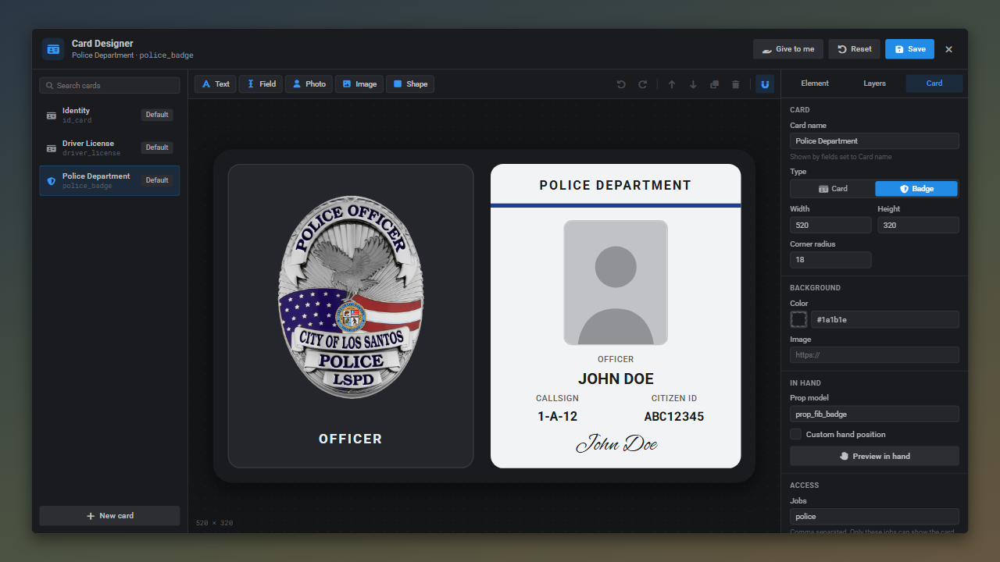
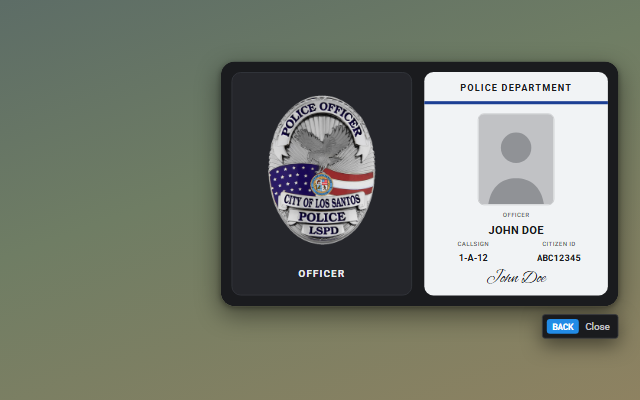

# Badges

A card with the type set to **Badge** is held as a badge prop (`prop_fib_badge` by default) instead of a card. Fill in **Jobs** to stop anyone else from showing it, so a fired officer can't keep flashing a police badge.



When it is shown, the closest player sees the badge wallet:



## Setting one up

1. Add the item to `ox_inventory/data/items.lua`, for example `police_badge`.
2. Either add it to `licenses` in `config/shared.lua` or create it with **New card** in `/idcards`:

```lua
['police_badge'] = {
    header = 'Police Department',
    kind = 'badge',
    background = '#1a1b1e',
    badge = 'examplebadge', -- web/public/badges/examplebadge.png
    prop = 'prop_fib_badge',
    jobs = { 'police' },
},
```

3. Issue it with `/givecard [id] police_badge`, **Give to me** in the designer or `exports.qbx_idcard:CreateMetaLicense(source, 'police_badge')`.

The badge stores the holder's job, grade and callsign when it is issued, so the **Job grade** and **Callsign** fields show the rank they had at that moment. Issue a new badge after a promotion.

## Hand position

The default badge animation and offset live in `handheld.badge` in `config/shared.lua`. Per card, tick **Custom hand position** and use **Preview in hand** to line up a different prop.
