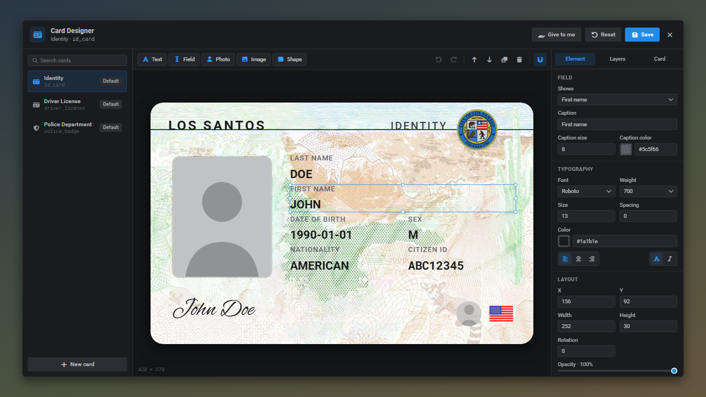
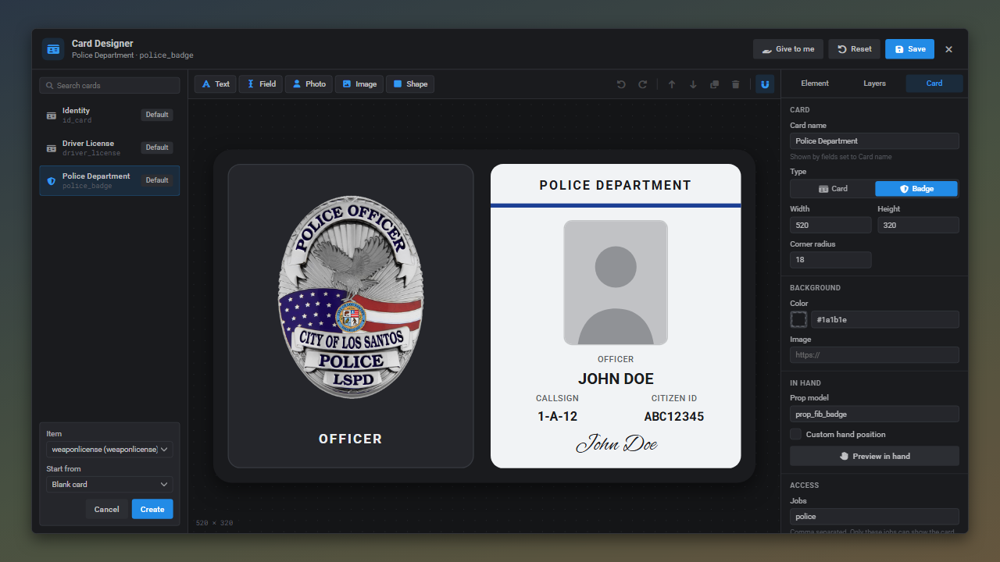
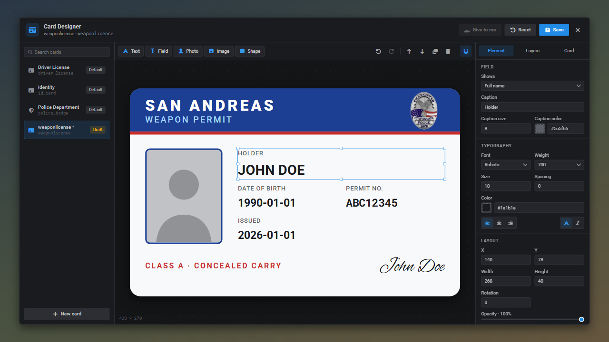
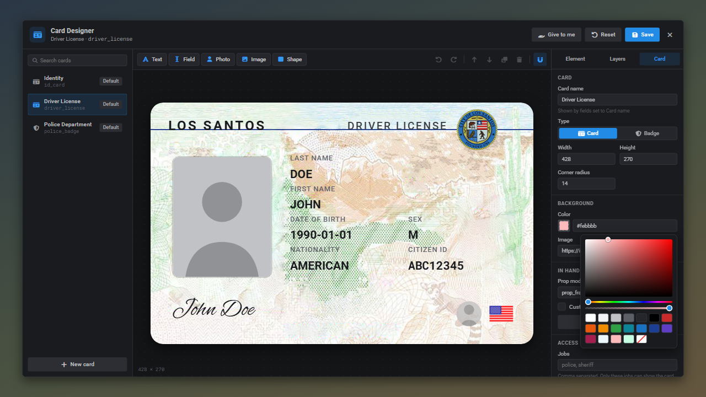
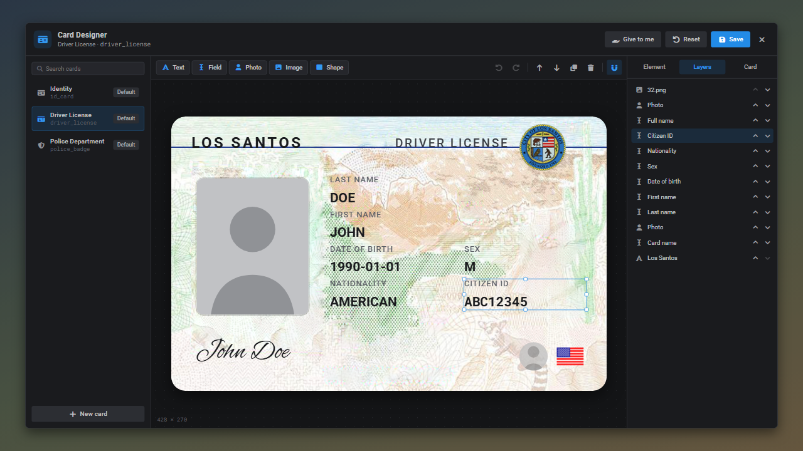

# The card designer

Admins design every card in game with `/idcards`. Designs are saved to the `qbx_idcard_templates` table and apply to every player straight away, no restart needed.

## Layout

| Area | What it does |
| --- | --- |
| Card list (left) | Every card item. **Default** comes from `config/shared.lua`, **Custom** is a saved design, **Draft** is a new card that isn't saved yet. A red `!` means the item is missing from ox_inventory. |
| Toolbar (top) | Add elements, undo/redo, layer order, duplicate, remove and snap to guides. |
| Canvas (center) | The card, filled with your own character data as sample data. Click to select, drag to move, pull the handles to resize. |
| Inspector (right) | **Element** edits the selection, **Layers** lists every element, **Card** holds the card settings. |
| Header (top right) | **Give to me** issues the card to yourself, **Reset** goes back to the default (or **Delete** for cards without a default), **Save** stores the design. |

## Making a new card

Press **New card**, pick any inventory item and choose where to start: the ID card layout, the badge wallet layout or a blank card.

Everything on a card is built from five elements:

| Element | Use it for |
| --- | --- |
| **Text** | Fixed text such as the state name, a class or a disclaimer |
| **Field** | Player data: full name, first/last name, date of birth, sex, nationality, citizen ID, card name, job, job grade, callsign or issue date. An optional caption shows above the value. |
| **Photo** | The holder's mugshot, optionally black and white |
| **Image** | A logo, seal or badge from an `https://` link or a file in `web/public` |
| **Shape** | Colored bars, stripes, frames and backgrounds |

This weapon permit was built from the blank preset with two shapes, two texts, a badge image, the photo and five fields:

## Styling

Text and fields have a font (Roboto, monospace, slab serif, condensed or signature), size, weight, color, alignment, letter spacing, uppercase and italic. Photos, images and shapes have a corner radius and a border. Every element has a position, size, rotation and opacity.

The color picker supports transparency and has quick swatches:

The **Layers** tab lists the elements top to bottom. Click one to select it, use the arrows to move it in front of or behind others.

## Shortcuts

| Key | Action |
| --- | --- |
| `Ctrl+Z` / `Ctrl+Y` | Undo / redo |
| `Ctrl+D` | Duplicate the selection |
| `Ctrl+S` | Save |
| `Delete` | Remove the selection |
| Arrow keys | Nudge 1px, hold `Shift` for 10px |
| `Shift` while dragging | Move freely without snapping |
| `Esc` | Deselect, or close the designer |

Elements snap to the card edges and center and to other elements. A red guide line shows what it snapped to.

## Card settings

| Setting | Notes |
| --- | --- |
| Card name | Shown by fields set to **Card name** |
| Type | **Card** holds the card prop, **Badge** holds the badge prop |
| Width / height | In pixels, the ID card preset is 428 × 270 |
| Background | A color and an optional image |
| Prop model | Overrides the default prop for the type |
| Custom hand position | Offset and rotation of the prop in the hand, **Preview in hand** plays the animation |
| Jobs | Only these jobs can show the card, empty for everyone. See [badges](badges.md). |
